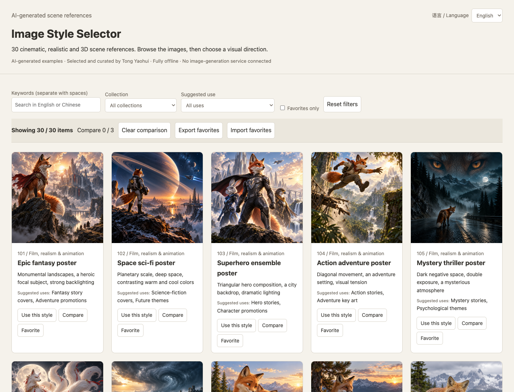

# Image Style Selector

[中文](README.md) | English

Browse 30 cinematic, realistic and 3D scene references, compare 2–3 items, compose prompts and back up favorites. The tool runs entirely offline without an image-generation service.

**All example images are AI-generated, selected and curated by Tong Yaohui. They are not real photographs, film stills or editable 3D models.** Code, documentation and bundled demos are provided under [MIT](LICENSE) to the extent applicable rights are held. No exclusive image copyright is claimed; see [the content notice](CONTENT_NOTICE.en.md).



The first public version is v1.0.0. The references retain IDs 101–130: IDs 101–120 cover film, realism and 3D animation, while IDs 121–130 explore creative realistic scenes. They are visual directions, not 30 wholly independent art styles. IDs 1–100, the complete private reference PDFs, personal records and historical archives are excluded. The original private collection remains unchanged.

For a ready-to-use offline package, download the offline ZIP from [Releases](https://github.com/tongyawhuei/image-style-selector/releases/latest), extract it completely, and open “首页.html”. The build steps below are for source users.

## Quick start

Build with Python 3.9 or later, using only its standard library:

```sh
python3 build.py
```

Open `dist/首页.html` directly. Select **English** at the top right to switch the interface, descriptions and reusable prompt templates. Use the **User guide** link in the footer for full bilingual instructions. No server, account or network is needed.

Favorites stay in the current browser. Export a JSON backup before moving the folder, switching browsers or clearing data. Both languages share favorites; subject text is not saved.

Create an offline ZIP:

```sh
python3 package.py
```

Build and package commands refuse to overwrite an existing destination. Move the previous output or choose a new path.

## Custom catalogs

Follow `examples/catalog.json`: each item needs a unique positive integer ID and text fields `name`, `title`, `features`, `uses`, `template`, `original`, `source`, `group` and `image`. IDs need not be consecutive. Chinese uses are separated with `、`. Image paths are relative to the catalog JSON.

To add English content, provide an `en` object containing `name`, `title`, `features`, `template`, `source` and `group` strings, plus a `uses` array aligned with the Chinese uses. English templates support `[subject]`, `[ratio]`, `[purpose]`, `[space]` and `[avoid]`; Chinese templates support `[主体]`, `[比例]`, `[用途]`, `[要求]` and `[元素]`.

```sh
python3 build.py --catalog private/catalog.json --output dist-custom
python3 package.py --site dist-custom --output artifacts/custom.zip
```

Only import content you have rights to use and distribute. The private folder is ignored by default. Building embeds catalog data into HTML; imported content does not automatically acquire an MIT license. Four simple placeholders remain available via `--catalog examples/placeholders/catalog.json` for lightweight testing.

## Development checks

Node.js 20+ is required for Playwright tests. These development packages are not bundled with the offline site:

```sh
npm ci
npx playwright install chromium
npm test
```

Use `STYLE_DIR` to select a built site, `CATALOG_FILE` to select its catalog, or `BROWSER_PATH` to use an installed Chrome/Edge executable. The bilingual checks cover all 30 references, language switching and state preservation, prompts, comparison, clipboard fallback and favorites export/import. Mac Chrome and Edge are tested; Windows and Safari have not been tested on actual devices.

[Bilingual verification](docs/双语版验收记录.md) · [Contributing](CONTRIBUTING.en.md) · [License](LICENSE) · [Content notice](CONTENT_NOTICE.en.md)
