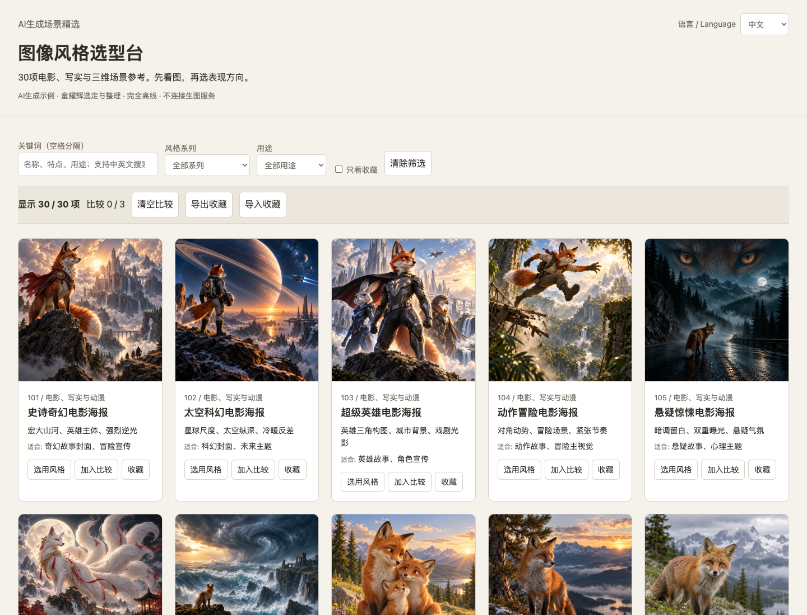

# 图像风格选型台

中文 | [English](README.en.md)

先看图，再选表现方向。附带30项电影、写实与三维场景参考，支持搜索、分类、2—3项比较、组合提示词、复制和收藏导入导出。完全本地离线运行，不连接生图服务。

**演示图均为AI生成，由童耀辉选定与整理；不是实地摄影、真实电影剧照或可编辑三维模型。** 代码、文档及随附演示图片/模板按 [MIT许可证](LICENSE) 提供，以依法享有的权利为限；不声称AI图片具有独占版权，见 [内容说明](CONTENT_NOTICE.md)。

首个公开版为v1.0.0。精选图保留自用图册编号101—130（101—120为电影/写实/三维，121—130为创意场景），不代表30种互不相关的独立艺术风格。编号1—100、整册PDF、个人记录及历史交付包不入公开候选；原130项自用版保留。

离线用户可从 [Releases](https://github.com/tongyawhuei/image-style-selector/releases/latest) 下载离线ZIP，完整解压后打开“首页.html”；下方构建步骤供源码使用者参考。



[English界面预览](docs/preview-en.png)

## 快速开始

构建只需Python 3.9或以上，不需要第三方Python依赖：

```sh
python3 build.py
```

双击 `dist/首页.html`，无需安装、服务器或联网。右上角选择中文或English，界面、30项说明与可组合模板同步切换；底部“使用说明”提供完整双语操作指引。收藏只存当前浏览器；移动目录、清理数据或换设备前，请导出收藏备份。主题内容不保存。

离线打包：

```sh
python3 package.py
```

构建和打包拒绝覆盖现有输出；重建时选新路径或自行移走旧输出。

## 自备图册

以 `examples/catalog.json` 的结构建立JSON数组，图像路径相对于JSON目录。每项需要唯一正整数id及name/title/features/uses/template/original/source/group/image字符串，ID可不连续。每项的 `en` 对象提供英文name/title/features/template/source/group及与中文用途一一对应的uses数组。英文模板支持 `[subject]`、`[ratio]`、`[purpose]`、`[space]`、`[avoid]`。中文模板支持 `[主体]`、`[比例]`、`[用途]`、`[要求]`、`[元素]` 组合占位符。

```sh
python3 build.py --catalog private/catalog.json --output dist-custom
python3 package.py --site dist-custom --output artifacts/custom.zip
```

仅导入有权使用和分发的素材。private目录默认忽略；构建会将图册内容嵌入HTML，发布自备图册前应单独核对其许可。简单占位图保留于 `examples/placeholders`，可用 `--catalog examples/placeholders/catalog.json` 构建轻量演示。

## 开发验证

需要Node.js 20或以上，Playwright仅用于验证，不随离线站点分发：

```sh
npm ci
npx playwright install chromium
npm test
```

`STYLE_DIR`可指定待验站点，`CATALOG_FILE`可指定对应图册，`BROWSER_PATH`可指定本机Chrome或Edge可执行文件。验收结果见 [验收记录](docs/双语版验收记录.md)，Windows未实机验证。

[30图公开核查](docs/30张公开核查.md) · [许可与素材](docs/许可与素材.md) · [贡献说明](CONTRIBUTING.md)

Offline image-style selector with 30 AI-generated cinematic, realistic and 3D reference examples. Build with Python, then open the generated HTML directly. Code and bundled demo content are provided under MIT to the extent the licensor holds applicable rights. This local candidate has not been published.
